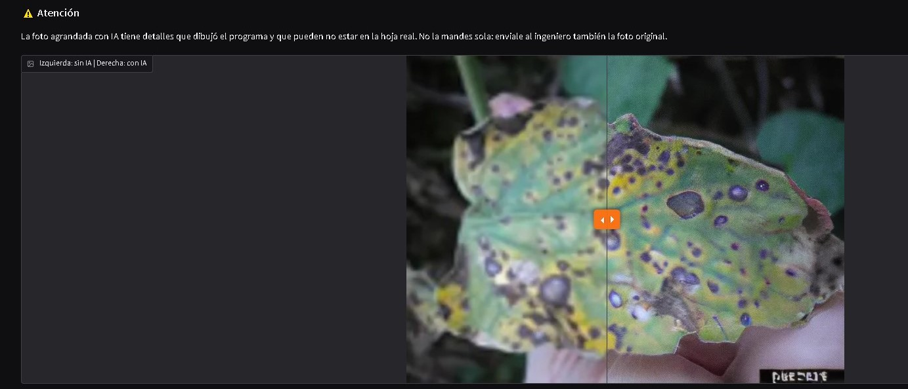
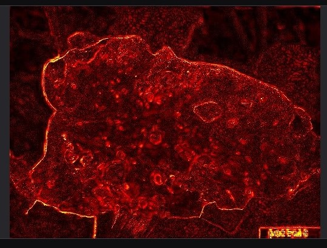
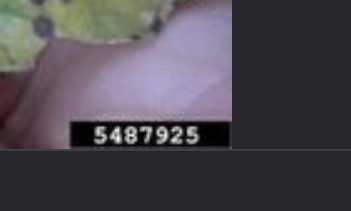
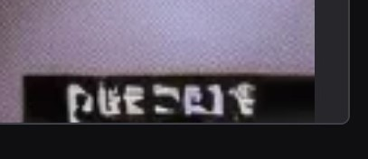
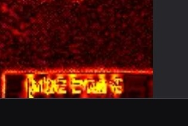
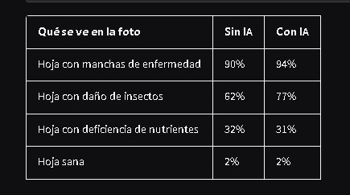

# Restaurador de fotos

## Declaración del Proyecto

Mi sistema permite que Ramón (productor hortícola de tomate y pimiento, sin conocimientos de IA) pueda agrandar 4 veces las fotos chicas y borrosas de sus hojas antes de mandárselas al ingeniero agrónomo, aplicando el modelo de difusión stabilityai/stable-diffusion-x4-upscaler y verificando resultados con SigLIP zero-shot, que compara la foto original con la agrandada. Le advierte que los píxeles nuevos los generó una IA: una mancha puede haber sido dibujada o borrada por el modelo, así que antes de diagnosticar hay que confirmarla con otra foto más de cerca o revisando la planta.

## Persona usuaria

**Nombre:** Ramón

**Edad:** 55-60 años

**Ocupación:** Productor hortícola (tomate y pimiento) en un campo chico

**Contexto tecnológico:** Usa WhatsApp todos los días con un celular viejo
de cámara de baja resolución. No sabe nada de inteligencia artificial.

**Problema actual:**
"Cuando veo una hoja rara le saco una foto y se la mando al ingeniero
agrónomo, pero me dice que no se ve nada: la foto sale chiquita y borrosa,
y por WhatsApp encima se achica más."

**Solución actual:**
Le manda varias fotos de la misma hoja esperando que alguna salga mejor,
o espera a que el agrónomo vaya al campo, que puede tardar días.

**Frustraciones:**
- Las fotos de su celular no tienen detalle suficiente para ver las manchas.
- Probó apps de "mejorar fotos", pero no sabe si lo que se ve después es
  la hoja de verdad o algo que agregó el programa.
- Teme que una mancha "inventada" (o una borrada) lleve a un diagnóstico
  equivocado y a aplicar un producto que no hacía falta.

**Objetivos:**
- Mandarle al agrónomo fotos más grandes y claras de sus plantas.
- Saber qué partes de la foto mejorada son reales y cuáles reconstruyó la IA.
- Que el agrónomo pueda diagnosticar sin tener que viajar al campo.

**Contexto de uso:**
A la tarde, después de recorrer el campo, en la computadora de su hija
o en la de la cooperativa. Tiene tiempo, pero no paciencia para
programas complicados.

## Descripción

Ramón saca fotos de las hojas enfermas de su huerta con un celular viejo y
se las manda al ingeniero agrónomo, pero salen chicas y borrosas. Esta app
agranda la foto 4 veces con un **modelo de difusión** y, al mismo tiempo,
le muestra **qué partes de la foto agrandada dibujó la IA** y cuáles venían
en la foto original.

Lo que la hace distinta de una app de "mejorar fotos" es que no le esconde
a Ramón lo que inventó el modelo: le muestra la misma foto agrandada **sin IA**
y **con IA**, un **mapa** de dónde cambió la imagen y un **análisis** que le
avisa si la IA pudo haber borrado o dibujado síntomas.

## Demo

[Link al video de 5 minutos]



## Qué es real y qué es inventado

**Qué hace el modelo.** La foto de Ramón tiene pocos píxeles. Cuando el
modelo la agranda x4, por cada píxel real tiene que generar 15 nuevos. Esos
píxeles **no estaban en la foto**: el modelo los dibuja de forma *plausible*,
según lo que aprendió de millones de imágenes. Además, el prompt
`"a close-up photo of a plant leaf"` lo empuja a dibujar "textura de hoja",
así que lo que agrega se ve como hoja, pero no es *esta* hoja.

**Cómo lo muestra la app.**
- **Comparador sin IA / con IA:** la versión "sin IA" está agrandada con
  interpolación bicúbica, que solo estira los píxeles que había y no
  inventa nada. Todo lo que es distinto en la versión con IA lo agregó el modelo.
- **Mapa de diferencias:** resta las dos versiones y pinta en rojo/amarillo
  dónde la IA dibujó más.
- **Análisis con SigLIP:** compara qué síntomas "ve" el modelo de visión
  en cada versión y avisa si alguno cambia 15 puntos o más.



**Qué encontré en mis pruebas.**
- En el mapa, el amarillo aparece en el **borde de la hoja** y en **anillos
  alrededor de cada mancha**. La IA no inventó manchas nuevas, pero
  **redibujó sus contornos**: la forma exacta del borde de cada mancha, que es
  lo que mira un agrónomo, es una suposición del modelo.
- **El modelo se equivocó con un número:** la foto `[hoja_04.jpg]` tiene la
  marca `5487925` en una esquina. En la versión con IA, el número se
  convirtió en símbolos que *parecen* letras pero no significan nada. El
  modelo no puede leer texto borroso: dibuja algo con forma de texto. Si la
  foto fuera de la etiqueta de un agroquímico o de la caravana de un animal,
  el resultado podría mostrar un número equivocado.
  
  | Foto original | Con IA | Mapa de diferencias |
  |---|---|---|
  |  |  |  |

- **El prompt cambia el resultado:** con el prompt en español, SigLIP vio
  menos síntomas en la versión con IA ("manchas" bajó de 90% a 71%). Con el
  prompt en inglés, los síntomas se mantuvieron (90% → 94%). El texto que le
  damos al modelo cambia lo que dibuja.



**Qué advertencia recibe Ramón.** Siempre ve el aviso: *"La foto agrandada
con IA tiene detalles que dibujó el programa y que pueden no estar en la
hoja real. No la mandes sola: enviale al ingeniero también la foto original."*
Si el análisis detecta un cambio grande, aparece además un ⚠️ que le dice qué
síntoma cambió y qué hacer.

**Cómo se verifica.** El resultado de la IA es *creíble*, pero no
*verificable* por sí solo. Para confirmar un diagnóstico hay que comparar con
la foto original, sacar otra foto más de cerca o que el agrónomo vea la planta.
**La foto agrandada nunca debería usarse como prueba.**

## Características

- Agrandado x4 con el modelo de difusión `stable-diffusion-x4-upscaler`
- Agrandado x4 sin IA (interpolación bicúbica) como línea base
- Comparador con deslizador: sin IA | con IA
- Mapa de diferencias: dónde dibujó la IA
- Análisis zero-shot con SigLIP 2 y advertencia automática
- Mensajes de progreso y de error en lenguaje simple

## Tecnologías utilizadas

**Entorno:** Python 3.12, uv

**Librerías:** gradio 6.32.0, diffusers 0.43.0, transformers 5.23.0,
torch 2.15.0, accelerate 1.15.0, pillow 13.0.0, numpy 2.5.4

**Modelos de IA:** los dos son pre-entrenados y se descargan de
[Hugging Face Hub](https://huggingface.co/) la primera vez que se ejecuta la
app (unos 4,7 GB en total). No entrené ningún modelo.

| Uso | Modelo | Versión (commit) | Licencia | Tamaño |
|---|---|---|---|---|
| Agrandar la foto x4 (difusión) | [stabilityai/stable-diffusion-x4-upscaler](https://huggingface.co/stabilityai/stable-diffusion-x4-upscaler) | `572c992` | CreativeML Open RAIL++-M | 3,3 GB |
| Analizar qué se ve en la foto (zero-shot) | [google/siglip2-base-patch16-224](https://huggingface.co/google/siglip2-base-patch16-224) | `75de2d5` | Apache 2.0 | 1,4 GB |

**Hardware con el que se probó:** AMD Ryzen 5 5500, 28 GB de RAM,
placa AMD Radeon RX 580 (no compatible con CUDA, así que el modelo corre en
CPU), Windows 10.

## Arquitectura del sistema

```
Foto de Ramón
     │
     ▼
achicar() ── reduce la foto a 128 px de lado como máximo
     │
     ├──► linea_base() ── bicúbica x4 ──────────► foto SIN IA ──┐
     │                                                          │
     └──► restaurar() ── difusión x4 ───────────► foto CON IA ──┤
                                                                │
          ┌─────────────────────────────────────────────────────┤
          ▼                          ▼                          ▼
   Comparador (deslizador)   mapa_de_diferencias()        analizar() (SigLIP)
                                     │                          │
                                     ▼                          ▼
                              mapa rojo/amarillo     tabla + aviso automático
```

| Archivo | Qué hace |
|---|---|
| `app.py` | Interfaz con Gradio: conecta todo y muestra los resultados |
| `src/diffusion.py` | Carga el upscaler una sola vez; `restaurar()` (con IA) y `linea_base()` (sin IA) |
| `src/analysis.py` | Carga SigLIP una sola vez; compara las dos versiones y arma el informe |
| `src/honesty.py` | `mapa_de_diferencias()`: resta las dos versiones y pinta dónde hubo cambios |
| `probar.py` | Prueba del upscaler sin interfaz, con una imagen de ejemplo |

## Instalación y ejecución

**Requisitos:** Python 3.12 y [uv](https://docs.astral.sh/uv/). No hace falta
GPU ni token de Hugging Face.

```bash
git clone https://github.com/mealla-sebastian-pln-1c2026/restaurador-fotos-MEALLA.git
cd restaurador-fotos-MEALLA
uv sync
uv run app.py
```

Después abrí http://127.0.0.1:7860 en el navegador.

**La primera ejecución descarga unos 4,7 GB de modelos** y puede tardar
varios minutos. Las siguientes veces arranca en segundos.

## Uso

1. Subí una foto de una hoja (o usá una de `assets/ejemplos/`).
2. Hacé clic en **Agrandar foto** y esperá (en CPU tarda unos 2 minutos).
3. Mové el deslizador para comparar la foto **sin IA** y **con IA**.
4. Mirá el **mapa**: lo amarillo es lo que más cambió la IA.
5. Leé la **tabla** y el aviso de abajo.

## Decisiones de diseño

**Por qué Gradio:** trae listo un comparador con deslizador (`gr.ImageSlider`)
y barra de progreso, que son las dos cosas que más necesita Ramón.

**Por qué el upscaler x4:** es el modelo de difusión de super-resolución más
liviano de la consigna, no pide token y anda en mi PC sin GPU NVIDIA.

**Por qué SigLIP 2:** permite preguntar por síntomas con frases ("hoja con
manchas de enfermedad") sin entrenar nada. Las frases están en inglés porque
así fue entrenado el modelo, y se le muestran a Ramón traducidas al español.

**Otras decisiones:**
- **Lado máximo de 128 px:** en CPU, entradas más grandes tardan demasiado.
- **Prompt en inglés:** el codificador de texto del modelo (OpenCLIP) fue
  entrenado en inglés. Con el prompt en español, los resultados cambiaban más.
- **Semilla fija (42):** la difusión parte de ruido al azar. Con semilla fija,
  la misma foto da siempre el mismo resultado y la app es reproducible.
- **Umbral de 15 puntos:** la app avisa cuando un síntoma cambia 15 puntos o
  más. Con un umbral más bajo avisaría siempre y Ramón dejaría de prestarle
  atención; con uno más alto se escaparían cambios importantes.
- **Mapa con escala fija (x4) y no relativa:** si dividiera por el cambio
  máximo, cualquier foto se vería llena de colores aunque la IA casi no la
  hubiera tocado. Con escala fija, si la IA cambió poco, el mapa se ve oscuro.

### Principios de Human-AI Interaction aplicados

- **Transparencia:** mensajes de progreso que dicen qué está pasando
  ("Dibujando los detalles con IA. Puede tardar unos minutos...").
- **Control:** el deslizador deja que Ramón compare él mismo las dos versiones.
- **Explicabilidad:** la tabla viene con una explicación de cómo leerla.
- **Honestidad sobre lo generado:** aviso fijo, mapa de diferencias y
  advertencia automática cuando un síntoma cambia mucho.
- **Manejo de errores:** si no sube foto, ve "Debes subir una foto primero."
- **Lenguaje simple:** nada de "strength", "steps" ni porcentajes sin explicar.

## Conceptos de procesamiento digital aplicados

- **Muestreo e interpolación:** `linea_base()` agranda con interpolación
  **bicúbica** (`Image.BICUBIC`), que se usa como línea base sin IA.
- **Resolución espacial:** `achicar()` reduce la foto con `thumbnail()`,
  que mantiene la proporción. La app trabaja con 128 px y devuelve 512 px.
- **Imagen como matriz:** en `honesty.py` la foto se convierte en una matriz
  de NumPy (alto × ancho × 3 canales RGB, valores de 0 a 255).
- **Operaciones aritméticas entre imágenes:** el mapa es la **resta** píxel a
  píxel en valor absoluto, promediada entre los 3 canales de color.
- **Pseudocolor:** la diferencia (en escala de grises) se pinta con un mapa de
  color negro → rojo → amarillo (`ImageOps.colorize`) para que se vea mejor.

## Uso de agentes de IA

- **Herramienta:** Claude Code, usado como tutor: me explicaba los pasos y yo
  escribía y ejecutaba el código.
- **Qué decidí yo:** la persona usuaria, la sub-tarea A, las imágenes de
  ejemplo, los textos que lee Ramón y como evaluar los resultados de la tabla.
- **Qué propuso el agente y cómo lo revisé:** la estructura de carpetas, el
  código de la advertencia automática y del mapa de diferencias, y un borrador
  de este README. Probé cada parte con mis imágenes y corregí errores, por
  ejemplo, cuando la función devolvía menos resultados que los que esperaba
  Gradio. Tuve que poner los prompt en inglés para mejorar el resultado.
- **Qué descarté y por qué:** la sub-tarea C (fotos dañadas, con FLUX
  Kontext), porque esos modelos no entran en mi PC sin GPU NVIDIA. También
  descarté una primera persona usuaria con fotos dañadas, porque no encajaba
  con la super-resolución.

## Limitaciones conocidas

- **Tiempo:** unos 2 minutos por foto en CPU (20 pasos, ≈6 segundos por paso).
- **La foto se achica a 128 px antes de procesarse.** Si Ramón sube una foto
  grande, la app pierde detalle al achicarla: la herramienta solo sirve para
  fotos que ya son chicas.
- **Texto y números:** el modelo los inventa (ver "Qué es real y qué es
  inventado"). No sirve para fotos de etiquetas, caravanas ni documentos.
- **SigLIP no diagnostica:** no fue entrenado para enfermedades de plantas.
  Sus porcentajes sirven para **comparar** las dos versiones, no para saber
  qué tiene la hoja.
- **El mapa compara contra la bicúbica, no contra la hoja real:** muestra qué
  agregó la IA, pero no si lo que agregó es correcto.
- Procesa una foto por vez.

## Trabajo futuro

- [ ] Probar con fotos reales de un celular viejo, no solo de internet
- [ ] Un control de "cuánto puede cambiar la IA la foto"
- [ ] Métricas (PSNR, SSIM) degradando fotos buenas y comparando con la original

## Autor

**Diego Sebastián Mealla**
Estudiante de la Tecnicatura Superior en Ciencias de Datos e IA - IFTS 24
Materia: Procesamiento Digital de Imágenes e Introducción a Visión por Computadora
Año: 2026

## Licencia

Código: MIT. Los modelos y las imágenes de ejemplo mantienen sus propias
licencias (ver tablas de arriba).

## Créditos de las imágenes de ejemplo

| Archivo | Autor | Licencia | Fuente |
|---|---|---|---|
| hoja_01.jpg | Wolan268 | CC0 | Wikimedia Commons |
| hoja_02.jpg | Wikimedia Commons |
| hoja_03.jpg | Wikimedia Commons |
| hoja_04.jpg | Elizabeth Bush, Virginia Tech | CC BY 3.0 | Wikimedia Commons |